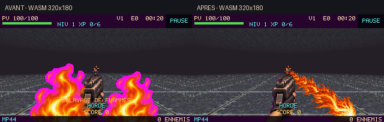

# Jet de flammes, salles de soins et duo permanent

Branche : `feature/flame-healing-two-secondaries`, base `main` à `9f6a412`.
Aucune fusion ni publication de `main` dans ce travail.

## Jet de flammes vers la profondeur

L’ancien rendu superposait deux flammes verticales au premier plan. Il est
remplacé par un atlas original de huit filaments horizontaux animés, projetés
par fragments depuis le bas droit vers le point de fuite. Taille, orientation
et position suivent la projection de la caméra et la distance. Les segments
validés par la géométrie bornent le jet : il s’arrête aux murs. L’ancien bandeau
« BALAYAGE DE FLAMMES » qui masquait l’effet a été retiré.

- [Avant/après WASM à 320×180](screenshots/before-after-320.png).
- [Avant/après WASM à 960×540](screenshots/before-after-wasm.png).
- [Avant/après natif SDL/GLES2](screenshots/before-after-native.png).
- [Phases animées capturées en jeu](screenshots/jet-in-game.gif).
- [Jet devant un mur](screenshots/flame-after/flame-wall-320.png) et
  [avec inclinaison de caméra](screenshots/flame-after/flame-pitch-960.png).



Les dégâts, la portée, le cône de recherche de cibles, la durée de salve et la
recharge du lance-flammes sont conservés. Il s’agit d’un jet texturé projeté en
perspective, pas d’une nouvelle simulation volumétrique. Les captures comparent
la même position, le même cadrage et le même état. Le GIF assemble huit phases
figées dans le vrai renderer ; ce n’est pas une vidéo continue d’une partie.

La planche source ImageGen est versionnée dans `tools/flame-source/jet-board.png`.
`tools/build_flame_atlas.py` extrait les cellules vers le contrat runtime
**768×128, huit frames 96×128**. Le détourage binaire évite les franges magenta
créées par la clé de composition du moteur avec les bords semi-transparents.
Les hashes de la source et du PNG final sont vérifiés par le manifeste.
Le runtime utilise uniquement le PNG versionné, sans génération au démarrage.

## Des soins à trouver dans les salles

Dans **JOUER et le Défi du jour**, les ennemis ne déposent plus de soins : chaque
ennemi laisse de l’XP, y compris les anciens multiples de quatorze éliminations.
Certaines **petites salles et salles bonus** sont approvisionnées avec trois
trousses de **16 PV** chacune, à des positions libres sur le sol.

Le choix des salles est déterministe à partir de la seed, sans consommer le RNG
combat : environ un tiers des salles admissibles sont sélectionnées, avec au
moins une si la map possède des salles admissibles. Le nombre total de trousses
est borné à 32. Les trousses sont séparées des drops d’XP : une accumulation
d’objets ennemis ne peut pas les faire disparaître.

Les trousses restent sur place, ne sont pas aspirées par l’aimant et demandent
de s’approcher sur le même étage. Elles ne sont pas consommées à PV pleins et
ne réapparaissent pas après ramassage. Les maps suivantes disposent de leur
propre distribution. La Horde conserve ses drops de soins antérieurs ;
les soins entre vagues, Vitalité et la récupération entre maps sont conservés.

[Capture d’une salle approvisionnée](screenshots/flame-after/healing-room-320.png).

## Deux secondaires, choisies définitivement

Le joueur acquiert au maximum **deux secondaires distinctes**. Tant qu’une place
est libre, les montées de niveau proposent une acquisition parmi les secondaires
accessibles et des bonus classiques. Les descriptions indiquent **CHOIX DÉFINITIF**.

Une fois les deux places prises :

- aucune troisième secondaire et aucun remplacement ;
- plus de proposition de secondaire déjà possédée ou de montée de son rang ;
- uniquement **Puissance, Cadence, Aimant et Vitalité** dans les offres ;
- les deux secondaires gardent leurs recharges indépendantes et leur ordonnanceur
  FIFO ; leurs départs restent espacés d’au moins une croche ;
- acquérir la seconde ne coupe pas le jet déjà actif et n’efface pas les projectiles ;
- le duo et ses recharges persistent jusqu’au bout des quatre maps, dans JOUER
  comme dans le Défi du jour. Une nouvelle partie permet de choisir un autre duo.

L’inventaire et le HUD restent bornés à deux places, également en Horde.
Les bonus classiques de dégâts et cadence continuent de renforcer les pouvoirs.
Les anciennes données de progression sont lues en conservant au plus deux
pouvoirs, sans rétablir l’ancienne exclusivité à une seule place.

[HUD des deux secondaires](screenshots/flame-after/duo-hud-320.png) ·
[Offres classiques une fois le duo complet](screenshots/flame-after/classic-upgrades-320.png).

## Tests et portée de validation

- **120 tests purs, 133 792 assertions** : réussis.
- **129 tests natifs SDL, 133 840 assertions** : réussis.
- **94 contrôles de simulation** : réussis.
- Smoke natif SDL/GLES2/Mesa : **600 frames**, réussi.
- Parcours **WASM desktop + mobile/HiDPI** : réussi, avec conservation du duo
  sur les quatre maps normales et quotidiennes, refus d’une troisième secondaire,
  menus, Horde, upgrades, boss, canon scié et rechargement du navigateur.
- Fixtures visuelles WASM en 320×180 et 960×540, ainsi que natives : jet,
  inclinaison, mur, salle de soins, HUD et bonus classiques vérifiés.
- **240 fichiers** source/package identiques, manifeste des assets et syntaxe
  PHP/JS/Python vérifiés ; aucun changement des règles du boss ou du canon scié.

Les tests couvrent le refus de remplacer un membre du duo, les offres classiques
sur 25 montées de niveau, la conservation des recharges sur toutes les transitions,
le déclenchement des deux pouvoirs avec espacement, la stabilité des soins par
seed, les collisions de placement, l’absence de soin ennemi dans les deux modes,
la résistance à 100 drops d’XP et la collecte sur le bon étage à PV manquants.
Les anciens tests d’exclusivité ont été adaptés au nouveau contrat de deux places.
La politique des outils de simulation sait remplir le duo et repérer les soins
proches ; aucun nouveau taux de victoire humaine n’est déduit de ces tests.

[Logs de validation](logs/). Les dossiers de captures contiennent les images
individuelles avant/après, desktop natif et WASM. Les captures de salles et d’offres
utilisent des fixtures explicites pour isoler le rendu et les transitions.

Le runtime natif et le binaire WASM sont ceux déjà préparés dans cette session.
Les sources PHP et les assets courants ont été repackagés, et la classmap Composer
locale a été actualisée pour inclure la nouvelle classe `RoomSupplies`.
Il n’y a pas eu de recompilation C/Emscripten ni de création d’exécutable Windows.
Le natif graphique utilise SDL GLES2, pas le backend OpenGL par défaut présentant
le défaut de décor déjà relevé. Les dépréciations PHP 8.5 existantes restent
exclues du niveau d’erreur natif ; les autres avertissements sont fatals.
Le mobile est émulé dans Chromium/SwiftShader, pas testé sur un téléphone physique.

## Sources et reproduction

Production : `Run.php`, nouvelle classe `RoomSupplies.php`, `PowerRenderer.php`,
`World.php`, `PlayScene.php` et `assets/sprites/arsenal/flame.png`, avec leurs copies
sous `games/slave-rift/`. La géométrie des salles et les autres armes ne changent pas.

```sh
python tools/build_flame_atlas.py
php tools/sync-package.php
python tools/blender/verify_assets.py
phpunit -c phpunit.pure.xml
php tools/simulation-test.php
# Playwright/Chromium et jeu servi avec COOP/COEP :
node tools/flame-review.cjs http://127.0.0.1:18999/ work/flame-review after
# Natif installé, sous X11/Xvfb :
SDL_RENDER_DRIVER=opengles2 JUMPHP_SMOKE=1 JUMPHP_HEADLESS_GL=1 JUMPHP_GL=1 \
  php -d error_reporting=24575 tools/flame-review-native.php /chemin/jeu-installe work/native-review
# Puppeteer et jeu servi :
node tools/rc-browser-test.cjs http://127.0.0.1:18999/ work/browser-tests
```
