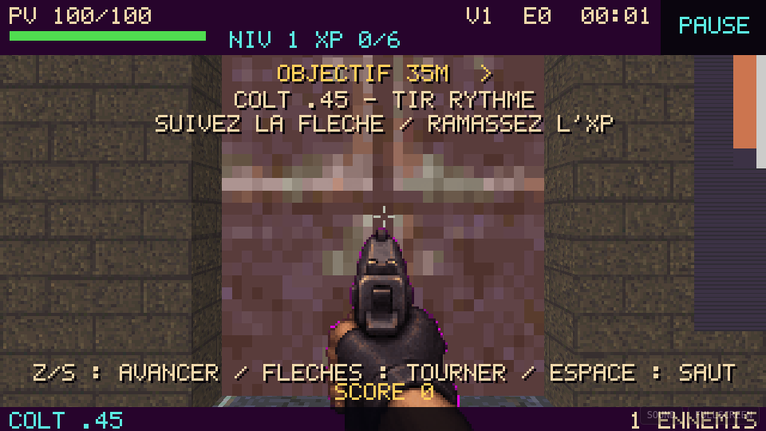
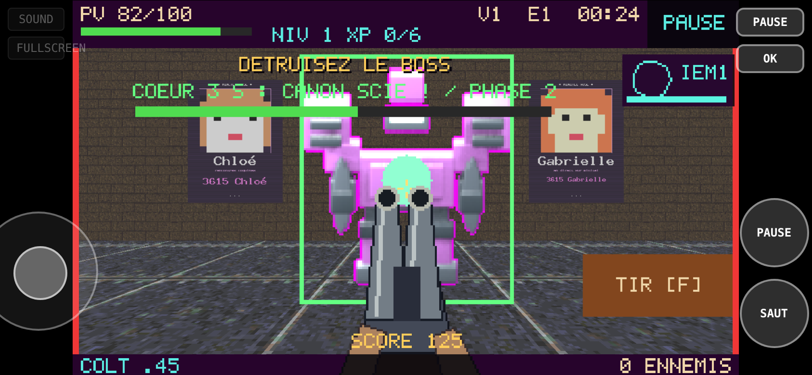

# Issue #5 — qualification initiale de la version complète

Ce rapport décrit la livraison sur la branche réservée avant intégration. L’intégration dans `main` est ensuite autorisée le 6 novembre 2026 ; voir [la variation musicale par session](session-melodies.md) pour la modification et les vérifications supplémentaires.

Branche : `feature/shotgun-bosses-procedural-gates`. Aucune fusion, aucun push forcé, aucune modification de `main`.

## Audit et choix

À l’ouverture, `main` et la branche réservée étaient identiques à `1e9ac385e29e3324494074673694965b347c0d24`. L’audit a conservé le générateur modulaire, les escaliers, la navigation persistante avec budget partagé, les sept paliers principaux, le pouvoir exclusif et `RhythmClock`. La règle du cœur était contournable par les tirs principaux et les explosions ; le boss ne produisait qu’une zone de dégâts au sol. Le lead et le contrechant étaient conditionnés aux niveaux 8 et 16.

## Réglages livrés

| Profil | PV de base | Vitesse | Dégâts | Lecture / apparition |
|---|---:|---:|---:|---|
| Runner fragile | 18 | 3,80 | 7 | Silhouette existante fine, attaque annoncée 0,40 s, activation 0,75 s |
| Guardian medium | 54 | 1,55 | 12 | Pression de poursuite, silhouette intermédiaire |
| Enforcer | 72 | 1,30 | 10 | Vise une position verrouillée pendant 0,65 s ; reprend la poursuite sans visibilité |
| Brute tank | 216 | 0,95 | 24 | Attaque annoncée 1 s ; distance initiale ≥ 8 unités, cible préférée 14 |

Les autres apparitions restent à ≥ 4,5 unités ; collision, support, étage, visibilité et espacement restent vérifiés. Les pondérations ouvrent sur 44 / 44 / 4 / 8 %, puis augmentent la part des tireurs et tanks. Les plafonds quotidiens restent 4→8 / 8→12 / 12→16 / 16→20 ; le budget total reste 520. Le scaling PV se fait une seule fois, sans augmenter les PV lorsqu’une arme progresse.

Le canon scié est un outil d’arène garanti, indépendant de l’XP et du slot de pouvoir : **8 pellets × 70 dégâts, dispersion déterministe, portée 7, recharge automatique 1,15 s, cartouches illimitées**. Le joueur doit viser et déclencher le tir. Desktop : maintenir **F** ; manette : **A** ; mobile : toucher le bouton **TIR** dans le jeu. Un tap est conservé jusqu’au prochain pas de simulation. Le sprite a quatre poses (repos, tir, recul, recharge), un recul visuel et un son propre. Tous les PNG/WAV sont dans le dépôt ; aucune génération ni téléchargement externe au runtime.

`BossController::damage()` refuse toute source autre que `shotgun`, y compris lorsque le cœur est ouvert et pour une attaque létale. Les tirs principaux, sniper, flammes, pulse et explosions peuvent gérer les modules, jamais les PV du cœur. Les tests exercent aussi le chemin réel d’explosion de `Run` et un boss dynamique.

Boss campagne / quotidien : **2 200 / 2 800 / 3 500 / 4 300 PV**, fenêtre de 6 s. Horde : 2 200 + 500 par palier de cinq vagues, plafonné à +2 500 ; fenêtres progressivement plus courtes. DPS idéal du canon scié ≈ 487 ; les phases, la précision, les modules et le positionnement réduisent le DPS effectif. Un boss ne demande pas de vider indéfiniment un chargeur.

Le boss annonce sa visée 0,9 s avant le départ. Projectiles fixes, sans poursuite, à 5,65 / 6,30 / 6,95 u/s ; phases à 1 / 3 / 5 projectiles en éventail. Rayon 0,18, durée de vie 6 s, plafond 24. Des sous-pas de 0,08 unité vérifient leur volume contre murs, portes et corps du joueur ; les tirs ne traversent pas les murs. Le rendu contrôle aussi l’occlusion. Départ, impact et charge ont des sons. L’EMP suspend projectiles, avertissement et fenêtre de vulnérabilité ; la reprise conserve leur phase. La mort du boss retire ses projectiles.

Les portes sont choisies dans les connecteurs du chemin principal à partir des salles générées, avec préférence pour les salles de combat et sans couper un escalier. Les coordonnées et dimensions viennent des connecteurs. Toutes sont fermées au départ et **s’ouvrent définitivement**, dans l’ordre, seulement quand le budget et les survivants sont épuisés. Une vague suivante attend l’entrée dans sa zone ; ses spawns ne peuvent se placer de l’autre côté de sa porte. Les BONUS appartiennent à la zone de leur parent. Collision joueur / ennemis / projectiles, rendu métallique, son d’ouverture et invalidation des travaux de navigation sont réels. Aucun survivant n’est téléporté ou supprimé. En mode normal : trois zones ; en quotidien : 3 / 4 / 5 / 6 ; la Horde ouverte conserve son fonctionnement.

Lead au niveau **2**, contrechant au niveau **6**. BPM 116 + 2 par niveau, transport unique sans reset entre maps, RNG musical séparé et banque TR-808/FreePats conservés. [WAV de 50 s](early-score.wav), [événements](music-events.json) : lead au changement vers le niveau 2 à 8 s, contrechant au niveau 6 à 24 s. Pic 0,913, RMS 0,134, **0 échantillon écrêté** ; contrats des 53 samples, canaux alternés bornés et arrêt audio vérifiés.

## TTK estimé par arme

Estimations `PV / DPS` du directeur à l’entrée de chaque palier, map 1, aucun rang de puissance manuel. Elles supposent une cible visible et des impacts constants : ce ne sont pas des TTK mesurés en mouvement. Un Colt inflige 38 par balle : runner / medium / tireur / tank nécessitent 1 / 2 / 2 / 6 impacts. Les maps suivantes appliquent leur scaling documenté.

| Arme | Niveau de référence | DPS estimé | Runner (s) | Medium (s) | Enforcer (s) | Tank (s) |
|---|---:|---:|---:|---:|---:|---:|
| Colt | 1 | 73.5 | 0.245 | 0.735 | 0.980 | 2.940 |
| Double Colt | 4 | 154.5 | 0.116 | 0.349 | 0.466 | 1.398 |
| MP44 | 8 | 172.9 | 0.104 | 0.312 | 0.416 | 1.249 |
| Double MP44 | 12 | 367.1 | 0.049 | 0.147 | 0.196 | 0.588 |
| BAR | 16 | 452.6 | 0.040 | 0.119 | 0.159 | 0.477 |
| Gatling | 20 | 533.9 | 0.034 | 0.101 | 0.135 | 0.405 |
| Double Gatling | 24 | 786.2 | 0.023 | 0.069 | 0.092 | 0.275 |

## Défi du jour avec dégâts actifs

Commandes et upgrades légales, trois politiques distinctes ; transport conservé sur les quatre maps. Aucun soin, XP, invincibilité ou dégâts injectés dans ces parties. La politique conserve son esquive jusqu’à l’arrivée du projectile au lieu de revenir immédiatement sur la position ciblée. Les noms des profils ne prédisent pas le talent ni le taux de victoire humain. Une mort interrompt naturellement la campagne ; les quatre maps sont tentées successivement lorsque le profil survit.

| Date UTC de défi | Profil | Résultat / dernière map | Durée cumulée | PV finaux | Kills | Boss vaincus | Portes ouvertes | Projectiles tirés / impacts reçus | CPU p95 maximum par map (ms) |
|---|---|---|---:|---:|---:|---:|---:|---:|---:|
| 2026-11-05 | faible | dead / 1 | 5:59 | 0/100 | 44 | 0 | 3 | 73 / 6 | 0.159 |
| 2026-11-05 | moyen | dead / 3 | 7:48 | 0/100 | 284 | 2 | 12 | 44 / 3 | 0.568 |
| 2026-11-05 | bon | won / 4 | 12:57 | 128/160 | 520 | 4 | 18 | 40 / 1 | 0.760 |
| 2026-11-06 | faible | dead / 1 | 4:11 | 0/100 | 44 | 0 | 3 | 53 / 6 | 0.224 |
| 2026-11-06 | moyen | dead / 2 | 4:16 | 0/115 | 132 | 1 | 7 | 50 / 6 | 4.508 |
| 2026-11-06 | bon | won / 4 | 14:17 | 10/100 | 520 | 4 | 18 | 44 / 4 | 4.782 |
| 2026-11-07 | faible | dead / 1 | 5:51 | 0/115 | 44 | 0 | 3 | 79 / 6 | 0.113 |
| 2026-11-07 | moyen | dead / 2 | 3:56 | 0/100 | 132 | 1 | 7 | 39 / 3 | 0.261 |
| 2026-11-07 | bon | dead / 4 | 11:57 | 0/100 | 520 | 3 | 18 | 56 / 4 | 0.788 |

Deux campagnes avec dégâts actifs sont terminées en **12:57 et 14:18**, dans la cible 12–18 minutes. Elles incluent quatre boss, quatre trésors, 18 portes et 520 éliminations. Les sept paliers principaux sont atteints, avec le canon scié utilisé séparément. Le profil bon du 7 novembre meurt sur la quatrième map : ce résultat est conservé. Les JSON par date contiennent les quatre seeds, chaque map, les PV et armes aux checkpoints, l’historique d’arsenal, les projectiles, survivants, budgets, portes et mesures CPU.

## Contrôle séparé sans dégâts

`--navigation-only` active l’invincibilité uniquement dans le fixture, sans modifier les commandes, armes, portes ou budgets. Ces durées ne prouvent pas un équilibrage humain. Le plafond est 30 minutes par campagne.

| Date | Profil | Résultat / dernière map | Durée | Survivants au terme | Portes encore fermées sur la map | Recherche sans chemin / budget A* épuisé |
|---|---|---|---:|---:|---:|---:|
| 2026-11-05 | faible | play / 2 | 29:59 | 0 | 0 | 69 / 69 |
| 2026-11-05 | moyen | won / 4 | 21:41 | 0 | 0 | 3 / 3 |
| 2026-11-05 | bon | won / 4 | 11:37 | 0 | 0 | 0 / 0 |
| 2026-11-06 | faible | play / 1 | 29:59 | 0 | 0 | 40 / 40 |
| 2026-11-06 | moyen | won / 4 | 15:52 | 0 | 0 | 0 / 0 |
| 2026-11-06 | bon | won / 4 | 15:40 | 0 | 0 | 1 / 0 |
| 2026-11-07 | faible | play / 2 | 29:59 | 0 | 0 | 36 / 36 |
| 2026-11-07 | moyen | won / 4 | 13:36 | 0 | 0 | 0 / 0 |
| 2026-11-07 | bon | play / 4 | 29:59 | 0 | 0 | 109 / 109 |

**Limite conservée :** les trois politiques faibles dépassent le délai, et le profil bon du 7 novembre dépasse le délai sur la map 4. Ces campagnes ne sont pas présentées comme réussies. La même géométrie est terminée par les autres politiques ; des tests isolés vérifient le trajet aller/retour avec le plus gros rayon et un survivant réel sur les quatre maps, ainsi que des seeds avec escaliers, branches et portes étroites. Les dépassements restent des limites de la politique de déplacement/visée, pas une preuve universelle d’absence de blocage. Les compteurs A* sans chemin et budgets épuisés restent visibles dans les JSON.

## Vérifications et limites de performance

- PHPUnit pur PHP 8.2 : **110 tests, 132 444 assertions** ; intégration native : **118 tests, 132 465 assertions**.
- Simulation : **94 contrôles** ; syntaxe, diff et miroir racine/package vérifiés.
- Nouveau coverage : source des dégâts du cœur et explosions, visée/portée/recharge du canon scié, projectiles mobiles, esquive, collision murs, plafonds, EMP/reprise, classes, spawns accessibles, fermeture/ouverture, reprise après mort, seeds identiques, musique précoce. Tests de poursuite : escaliers dans les deux sens et quatre maps traversées par un survivant.
- SDL logiciel : smoke de **600 frames** ; OpenGL natif X11/Mesa : capture après 180 frames.
- [Poursuite procédurale](pursuit-stress.json), population conservée et portes explicitement ouvertes pour isoler la géométrie : p95 **0,731 ms à 25**, **1,770 ms à 50**, aucune recherche échouée.
- [Horde](horde-stress.json), CPU seul : p95 **0,681 / 0,993 / 2,349 / 8,006 ms** à **25 / 50 / 100 / 200** ennemis. Les maxima restent publiés ; ils ne sont pas masqués par la moyenne.
- WASM Chromium desktop et mobile/HiDPI : vrais clics, clavier et taps ; menus, replay, quatre écrans de maps, Horde, pouvoir exclusif, combat/trésor et tir volontaire au cœur. Ces transitions de menu utilisent des fixtures explicites ; les parties complètes sont celles des JSON PHP ci-dessus.
- **Le mobile est une émulation Chromium**, pas un téléphone physique. Les métriques WebGL utilisent SwiftShader : rendu logiciel très lent, environ 100–200 ms par frame selon la foule, donc **aucune affirmation de 60 FPS ni de performance GPU/mobile réelle**. Les métriques et captures sont jointes. Les percentiles CPU quotidiens ont été mesurés avec d’autres validations en cours et incluent la contention de l’hôte ; ce ne sont pas des mesures exclusives sur matériel cible.
- La création de l’image Docker native multicouche a dépassé le disque de l’environnement. Les mêmes versions d’extensions épinglées ont été compilées dans un conteneur unique PHP 8.2 pour les validations locales. Le moteur WASM vient de la release épinglée avec SHA vérifié et du packager Emscripten 3.1.35. La CI utilise les builds officiels PHP 8.2/8.5 et Docker SDL/OpenGL.

## Reproduire

```sh
php tools/sync-package.php --check
phpunit -c phpunit.pure.xml
php tools/simulation-test.php
php -n tools/sampler-contract-test.php
php tools/pursuit-stress.php
php tools/horde-stress.php
php tools/daily-pursuit-report.php 2026-11-06 > daily.json
php tools/daily-pursuit-report.php 2026-11-06 /tmp/navigation.json --navigation-only > navigation.json
php tools/music-events.php > /tmp/events.json
python tools/render_music_demo.py /tmp/events.json
# Avec le moteur JumPHP épinglé par les workflows :
bin/jumphp test slave-rift
bin/jumphp build slave-rift
node tools/rc-browser-test.cjs http://127.0.0.1:18999/ screenshots
```

Les artefacts Windows et WASM sont construits pour la branche réservée. Le workflow de publication `gh-pages` reste limité à `main` et n’est pas utilisé ici. Les modifications documentaires seules ne relancent pas les gros builds.

## CI et artefacts

Code qualifié : `d6a07b7` (les commits suivants ne contiennent que le rapport et ses artefacts). **Les trois pipelines sont réussis** :

- [Survival checks — PHP 8.2/8.5 et SDL/OpenGL](https://github.com/tueb2024/slave-rift-jumphp/actions/runs/42227730543) : 110 tests / 132 444 assertions sur chaque PHP ; intégration CI PHP 8.5 : 118 tests / 131 541 assertions ; smoke 600 frames et captures OpenGL réussis. Les comptes d’assertions des smokes natifs varient avec leur déroulement ; le nombre de tests reste identique.
- [Windows standalone](https://github.com/tueb2024/slave-rift-jumphp/actions/runs/42227730426) : [télécharger l’exécutable et SHA256SUMS](https://github.com/tueb2024/slave-rift-jumphp/actions/runs/42227730426/artifacts/13507315316).
- [WASM desktop et mobile](https://github.com/tueb2024/slave-rift-jumphp/actions/runs/42227730528) : [télécharger le jeu web](https://github.com/tueb2024/slave-rift-jumphp/actions/runs/42227730528/artifacts/13506906737) ; [captures et métriques CI](https://github.com/tueb2024/slave-rift-jumphp/actions/runs/42227730528/artifacts/13507086507). Le test de navigateur complet réussit aussi en local sur le code final.

Les artefacts GitHub demandent une connexion au dépôt et sont conservés 14 jours. Le ZIP Windows contient l’exécutable prêt à lancer. Le ZIP WASM doit être servi via HTTP avec les en-têtes COOP/COEP du Caddyfile JumPHP, puis ouvert dans le navigateur ; ne pas ouvrir `index.html` en `file://`. Aucun de ces builds ne publie sur `gh-pages`.

Les timings WebGL locaux finaux donnent un p95 de **82 / 92 / 99 / 115 ms sur desktop** et **157 / 172 / 196 / 201 ms en mobile/HiDPI** pour 25 / 50 / 100 / 200 ennemis en rendu logiciel. Voir les JSON pour les tailles d’échantillons et le temps CPU par frame rendue.

Le contrat audio utilise des stubs SDL : `php -n` évite les redéfinitions lorsque le runtime natif a déjà chargé SDL_mixer. La syntaxe a aussi été vérifiée avec `php -n -l` dans cet environnement.




`main` a été revérifié à `1e9ac385` après les builds. Aucune fusion ni modification de cette branche. Les premiers runs intermédiaires ont révélé les anciens seuils du contrat audio et le fixture de poursuite qui gardait désormais les portes fermées ; ces contrats ont été adaptés explicitement.
