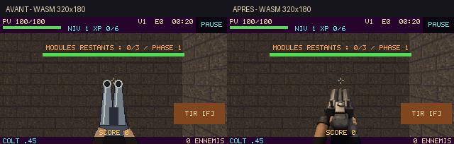

# Issue #7 — refonte du canon scié à examiner avant intégration

Branche : `feature/issue-7-shotgun-art`. Base : `e3d21852a75991a2e530d4fef9d3657c08dd0f3d`.
Aucune fusion dans `main`, aucune publication du jeu.

## Résultat visuel

Le canon scié a été reconstruit avec un modèle Blender original : deux tubes courts,
culasse large à charnière, chiens, levier d’ouverture, vis, guidon en laiton,
bois sombre quadrillé, métal bleui texturé et mains à gants noirs. La caméra FPS
regarde la culasse et le dessus des tubes vers l’avant ; les deux disques de
bouche regardant le joueur dans l’ancien dessin ont disparu. Une lumière douce
chaude supérieure gauche et un remplissage discret font ressortir les arêtes.
Le flash éclaire réellement le métal dans les deux poses concernées.

L’atlas passe de quatre poses plates (384×128, 2 368 octets) à huit poses
(768×128, 10 823 octets) : repos, amorce, flash, recul, ouverture, insertion de
deux cartouches, fermeture et retour. Tous les rendus partagent la même géométrie,
les mêmes matériaux et la même caméra. Le recul est intégré aux poses ; le
second décalage vertical du renderer a été retiré pour éviter son cumul.
La boîte d’affichage est celle des armes principales simples (135 pixels de
haut à la résolution logique 320×180). Le réticule reste dégagé au repos.

La comparaison avec les sept armes est visible ci-dessous. La correspondance
artistique reste à votre appréciation : les références sont des sprites peints,
le nouveau canon scié est un rendu 3D texturé réduit. Les tests ne certifient pas
une égalité subjective de finition.

- [Avant/après WASM — véritable viewport 320×180](screenshots/wasm-before-after-320.png)
- [Avant/après WASM — viewport 960×540](screenshots/wasm-before-after-960.png)
- [Avant/après desktop natif SDL/GLES2](screenshots/desktop-before-after.png)
- [Les huit armes dans la même salle et au même viewport](screenshots/arsenal-in-game.png)
- [Cycle du nouveau canon scié, captures en jeu](screenshots/reload-in-game.gif)



Les dossiers `screenshots/wasm-before-*`, `wasm-after-*` et `desktop-after/`
contiennent les captures individuelles, notamment tir, recul et recharge.
Les planches assemblent ces captures sans retoucher le sprite. Le GIF reprend
les poses gelées en jeu selon leurs durées ; ce n’est pas un enregistrement vidéo
continu. Le décor, la position, l’orientation, le temps et le viewport sont fixes.
Le boss est actif uniquement pour sélectionner l’arme, sans modèle placé devant
le joueur. Les captures de comparaison sont donc des fixtures de revue dans le
vrai renderer, distinctes des essais de combat avec entrées réelles.
Seuls les boutons HTML SOUND/FULLSCREEN sont masqués pendant la revue ; le HUD
et le bouton de tir du jeu restent visibles.

## Audit des pipelines

Les sept armes réellement chargées sont `assets/sprites/arsenal/{pistol,
dual_pistol,smg,dual_smg,machinegun,minigun,dual_minigun}.png` : huit cellules
96×128, silhouettes sombres, métal usé à reflets chauds, mains gantées, détourage
et détails peints. Elles proviennent de la création ImageGen déjà sélectionnée
par le propriétaire, pas des armes génériques de `assets/generated/weapons/`.
Le relevé des dimensions, bornes alpha et tailles se trouve dans
[asset-audit.json](asset-audit.json).

Le pipeline Blender existant (`art_spec.py`, `generate_weapons.py`,
`render_sprites.py`) produit des armes industrielles génériques en 144×96 avec
caméra orthographique oblique. L’utiliser tel quel aurait conservé un décalage
avec l’arsenal actif. La nouvelle entrée Blender dédiée reprend la génération
procédurale éditable, mais fournit caméra perspective FPS, surfaces texturées,
huit poses articulées et le contrat 96×128 réellement consommé par le jeu.
La tentative de génération ImageGen a été refusée par l’outil ; elle n’a fourni
aucun pixel de l’asset livré.

Sources versionnées : `tools/blender/render_shotgun.py`,
`tools/blender/shotgun-source/shotgun.blend`, huit `pose-*.png`, `manifest.json`.
Le packing applique une réduction 3:1, un seuil alpha binaire et une palette de
256 couleurs. Le modèle reste hors de `games/slave-rift/` ; seul l’atlas runtime
est dupliqué. Les hashes couvrent modèle, plaques sources et PNG final.

```sh
blender -b --factory-startup --python-exit-code 1 --python tools/blender/render_shotgun.py
# Python + Pillow, uniquement au moment de l’édition :
python tools/build_shotgun_assets.py
php tools/sync-package.php
python tools/blender/verify_assets.py
```

Le script `build_shotgun_assets.py` ne génère plus de sons avec les sprites.
Aucun WAV n’a été modifié. Les autres armes et le pipeline Blender général
restent inchangés.

## Intégration et protection des mécaniques

La seule classe de production modifiée est `Gfx/WeaponRenderer.php`, identique
sous `src/` et `games/slave-rift/src/`. Elle sélectionne les huit poses à partir
du compteur de recharge existant : 0–25 ms amorce, 25–60 ms flash, 60–180 ms recul,
180–420 ms ouverture, 420–780 ms insertion, 780–1 000 ms fermeture,
1 000–1 150 ms retour. La simulation ne reçoit aucun nouveau compteur.

Aucune modification de `src/Game/` : portée, dégâts, projectiles, boss,
vulnérabilité, déclenchement volontaire, recharge **1,15 seconde**, exclusivité
des dégâts du cœur, pouvoir secondaire et progression sont conservés.
Les contrôles existants de ces comportements sont exécutés avec le nouvel asset.
`ArsenalDailyTest` attend désormais 768×128 également pour le canon scié ;
`WeaponRendererTest` vérifie le parcours des huit poses et le format de l’atlas.

## Validation locale

- PHPUnit pur, PHP 8.5.12 : **113 tests, 132 763 assertions**, réussi.
- Intégration native SDL, PHP 8.5.12 : **121 tests, 132 784 assertions**, réussi.
- Simulation : **94 contrôles**, réussis.
- Smoke natif SDL/GLES2/Mesa : **600 frames**, réussi.
- Parité source/package : **237 fichiers**, vérifiée ; atlas SHA-256 identique
  `c412e242a55ff2b6a54c4290990107aed25899ef2edc70bf70e6be5db8db3a52`.
- Vérification des 46 assets générés existants et du nouveau manifeste du canon
  scié, syntaxe Python/PHP/JS et `git diff --check` : réussis.
- Captures WASM 320×180 / 960×540 : WebGL actif, atlas chargé **768×128**, aucune
  erreur PHP/JS relevée. Captures natives : GL actif, même atlas et mêmes poses.

Les logs sont dans [logs/](logs/). Le [test navigateur complet desktop/mobile](logs/browser-test.log) est **réussi** :
vrais clics, touches et taps, menus, quatre maps, Horde, upgrades, tir manuel au
cœur, projectiles du boss, trésor et persistance après rechargement du navigateur.
Les captures `screenshots/combat-*.png` montrent le combat réel testé, distinct
des poses gelées de comparaison. Les métriques SwiftShader sont conservées dans
les deux fichiers `*-webgl-performance.json`, sans promesse de performance GPU.

### Environnement et limites

Le dépôt moteur historique `davidnurdin/jumPhp` renvoie 404 dans cet environnement.
Le commit **exact** épinglé par les workflows, `28ea932981fb0b6d8dc41f2c9739f941cb4befea`,
a été retrouvé dans `malabke/jumPhp`. Les sources PHP moteur extraites du build
WASM de référence correspondent à celles de ce commit pour le renderer vérifié.
Le binaire WASM existant de `gh-pages` a été conservé, sans modification ; les
fichiers PHP et assets courants ont été repackagés dans son système de fichiers.
Ce contrôle charge donc le vrai nouvel asset dans le vrai runtime PHP/WASM,
mais ne constitue pas une recompilation de l’outil C/Emscripten.

Le runtime natif a été compilé dans un conteneur PHP 8.5 avec les versions SDL et
OpenGL épinglées. Le commit SDL a été récupéré depuis `Ponup/php-sdl`, où il est
disponible. Le backend SDL **GLES2** donne le décor et le sprite attendus, comme
WASM. Le backend SDL OpenGL par défaut de cette machine produit déjà un décor
corrompu avec **l’ancien** asset ; il n’est pas présenté comme validé. Une
[capture du défaut](logs/desktop-opengl-backend.png) est conservée. Ce pass ne
modifie pas le moteur pour corriger cette anomalie indépendante.

Les dépréciations PHP 8.5 déjà présentes (`imagedestroy`) ont été exclues du
niveau d’erreur des smokes natifs (`error_reporting=24575`) ; les autres erreurs
et avertissements restent fatals. Chromium utilise SwiftShader ; le mobile est
émulé, sans preuve de performance sur téléphone physique. Aucun exécutable
Windows n’a été construit ici et aucune réussite des anciens workflows GitHub
avec leurs dépendances indisponibles n’est annoncée.

Pour reproduire les captures sur un jeu installé avec le moteur :

```sh
# Playwright/Chromium disponibles, jeu servi via HTTP avec COOP/COEP :
node tools/shotgun-capture.cjs http://127.0.0.1:18999/ work/review-320 320
node tools/shotgun-capture.cjs http://127.0.0.1:18999/ work/review-960 960
# Runtime natif disposant de SDL, GD et OpenGL, sous X11/Xvfb :
SDL_RENDER_DRIVER=opengles2 JUMPHP_SMOKE=1 JUMPHP_HEADLESS_GL=1 JUMPHP_GL=1 \
  php -d error_reporting=24575 tools/shotgun-capture-native.php /chemin/jeu-installe work/native-review
```

`tools/shotgun-visual-fixture.php` n’est jamais chargé par l’entrée du jeu.
