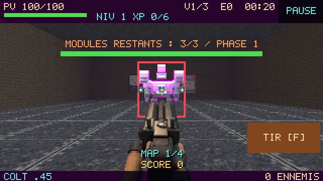
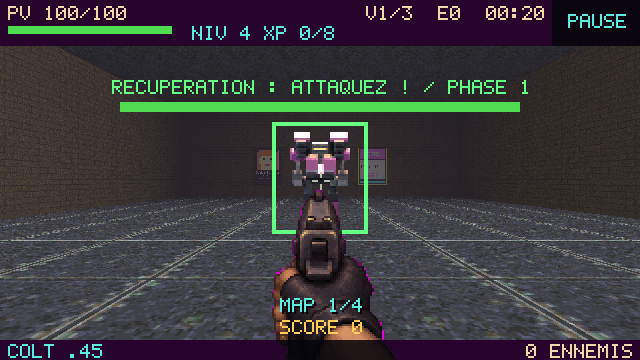

# Canon scié initial, acquisitions XP et boss mobile

Branche : `feature/manual-shotgun-boss-rebalance`, base `a98fb84`.
Les changements précédents du canon scié, du jet de flammes, des soins et des deux secondaires sont conservés. Aucun merge dans `main` dans cette livraison.

## Progression

Une nouvelle partie commence au canon scié dans **JOUER, DÉFI DU JOUR et HORDE**. Visée manuelle, déclenchement F/clic/A/TIR, huit plombs, portée 7, recharge 1,15 s. Aucun tir automatique avant acquisition d'une arme rythmique. Le canon reste disponible tant que le Colt n'est pas acquis.

Les armes sont des **choix de montée de niveau**, pas des récompenses automatiques de kills ou du niveau lui-même. À chaque palier admissible, l'acquisition suivante est garantie parmi les trois propositions ; le joueur peut choisir un bonus classique et reporter l'acquisition.

| Acquisition | Niveau minimum | Intervalle depuis la précédente |
|---|---:|---:|
| Colt | 4 | — |
| Double Colt | 9 | 5 |
| MP44 | 15 | 6 |
| Double MP44 | 23 | 8 |
| BAR | 33 | 10 |
| Gatling | 45 | 12 |
| Double Gatling | 59 | 14 |

L'arme acquise et les rangs sont transférés entre les quatre maps. Rejouer ou réinitialiser recrée une partie au canon scié. Le duo secondaire reste permanent et plafonné à deux : aucun remplacement ni troisième secondaire. Les acquisitions principales constituent désormais un choix supplémentaire aux paliers ci-dessus, indépendamment de ce plafond.

Les modes partagent la courbe XP `6 + floor(0,7 × (niveau − 1))`. L'ancienne progression quotidienne par kills et sa courbe plus coûteuse sont retirées pour que les paliers tardifs restent accessibles dans les 520 ennemis du défi. Les salles de soins et l'absence de soins lâchés par les ennemis en campagne restent en place.

## Boss et rendu

Le boss ne nécessite plus de canon scié : toutes les armes principales et secondaires endommagent son corps, sans modules préalables. Son blindage ne laisse passer que 35 % des dégâts pendant le barrage. Les anciennes classes de rencontre murale restent compatibles, mais les modes jouables créent le nouveau boss mobile.

- Marche et strafe réels, déplacement à 3,55–4,65 unités/s selon la phase, rotation vers le joueur et collisions avec les murs.
- Première récupération de 6 s pour rejoindre la sortie ; ensuite avertissement 1,2 s, barrage 2,2 s, récupération 3,2 s.
- Éventails de sept projectiles, répétés toutes les 0,16–0,245 s selon map et phase. Trajectoires avec collision continue : les murs du refuge arrêtent les projectiles.
- La dernière salle avant l'arène est une petite salle accessible, avec un retour possible pendant le combat. La Horde reçoit une annexe latérale reliée par une vraie ouverture.
- PV par map : **9 000 / 24 000 / 64 000 / 150 000**. En Horde : `9000 + 6000 × (rangBoss − 1)^1,6`, sans arrêt au sixième boss.

Le nouveau modèle Blender remplace la silhouette de siège fixe par un marcheur magenta : jambes articulées et pistons, pieds griffus, épaules séparées, signal de charge et flash de tir. La palette conserve la lecture de la classe brute. **80 poses** (10 lignes × 8 directions), Cycles 24 échantillons, key/fill/rim, réduction de 192×224 à 96×112 ; atlas actif 768×1120 à transparence binaire. Le renderer choisit direction, marche, charge et attaque à 12 images/s ; un mur masque désormais le corps du boss.

Sources : [modèle éditable](../../tools/blender/raider-source/raider.blend), [géométrie](../../tools/blender/raider_parts.py), [rendu](../../tools/blender/render_raider.py), [assemblage](../../tools/build_raider_atlas.py). Le générateur général et son fallback utilisent la même nouvelle géométrie. Le manifeste vérifie les empreintes du modèle et de l'atlas.

## Captures prises dans le jeu

Captures natives SDL/GLES2/Mesa à 640×360. L'avant provient du runtime de référence `9f6a412`, dont le boss est identique à celui de `a98fb84`. L'après utilise le nouveau runtime. Seed 42, entrée d'arène identique. Le script de revue prépare l'état et fige la phase pour comparer les poses ; ces images sont produites par le moteur du jeu, pas par un compositing Blender.

| Avant | Après |
|---|---|
| [Départ au Colt](before-starter.png) | [Départ au canon scié](after-starter.png) |
| [Siège fixe](before-boss.png) | [Marcheur en récupération](after-boss-recover.png) |




Autres vues : [offre XP légale au niveau 4](after-xp-weapon-offer.png), [Colt acquis](after-acquired-colt.png), [charge annoncée](after-boss-windup.png), [barrage](after-boss-barrage.png), [refuge derrière le mur](after-adjacent-refuge.png). [Coordonnées du refuge et absence de ligne de vue](after-cover.json).

WASM dans Chromium/WebGL : [desktop](wasm-desktop-boss.png), [mobile avec viewport haute densité](wasm-mobile-boss.png). Le scénario vérifie qu'une arme acquise retire des PV sans déclencher de canon scié.

## Simulations de difficulté

### Combats isolés : 36 cas, moteur de combat réel

Seeds 1, 42, 1337 × quatre maps × trois politiques. Budgets représentatifs fixés **avant** le combat : niveaux 14/26/42/62, Double Colt/Double MP44/BAR/Double Gatling, rangs de puissance 3/7/12/18, PV joueur 100/130/160/180. Ennemis ordinaires et portes de rencontre retirés pour isoler le boss. Aucun changement de stats ni invincibilité pendant le combat. Mouvement, visée, rythme, dégâts, murs et projectiles sont ceux du jeu ; limite 240 s.

| Politique | Victoires | Durée jusqu'à victoire ou mort |
|---|---:|---:|
| Immobile exposé | 0/12 | mort en 14,60–15,10 s |
| Strafe dans l'arène | 0/12 | mort en 21,27–27,77 s |
| Refuge pendant charge/barrage, retour pendant récupération | 12/12 | victoire en 45,90–92,50 s |

La politique de refuge ne reçoit aucun impact dans ces 12 cas. Elle bénéficie d'une lecture parfaite de l'état du boss : ce résultat vérifie le fonctionnement du couvert et la possibilité de gagner avec ces builds, pas le niveau de risque d'un humain. Les deux autres politiques confirment que rester exposé est fortement puni. [Données complètes](boss-cover.json).

### Campagnes : acquisitions légales et parcours complet

Six campagnes JOUER, limite 1 200 s **par map**, bots sans changement de stats :

| Seed | Profil | Résultat | Temps simulé total |
|---|---|---|---:|
| 1 | moyen | Mort map 1, boss atteint avec 37 PV | 110,3 s |
| 1 | bon | Limite de temps map 4 avant le boss | 1 811,3 s |
| 42 | moyen | Victoire, quatre maps | 1 082,1 s |
| 42 | bon | Limite de temps map 4 avant le boss | 1 841,9 s |
| 1337 | moyen | Mort map 4 | 1 058,7 s |
| 1337 | bon | Victoire, quatre maps | 1 054,9 s |

Les timeouts sont des résultats incomplets des politiques de navigation/ciblage, pas des victoires. Le profil nommé « bon » n'est pas une garantie de meilleure performance pour chaque seed. [Seed 1](campaign-seed-1.json), [seeds 42 et 1337](campaign-seeds-42-1337.json).

Défi du **2026-11-08**, budget global de 1 800 s : profil faible mort map 1 à 13,9 s ; moyen atteint la map 4 sans finir avant la limite ; bon remporte les quatre maps en **1 030,8 s**, soit 17 min 11 s. [Données complètes](daily.json).

Ces résultats rendent le nouveau combat gagnable tout en sanctionnant l'exposition et montrent un parcours complet possible avec des acquisitions légales. Ils ne constituent pas un taux de victoire humain ni une validation exhaustive de toutes les seeds, de tous les builds ou de la Horde prolongée. Une session humaine reste nécessaire pour juger le ressenti et la lisibilité du timing.

## Vérifications

- Suite pure : **124 tests, 139 433 assertions**, réussie.
- Suite native : **133 tests, 139 481 assertions**, aucun échec. Cinq sites existants utilisant `imagedestroy()` produisent des dépréciations sous PHP 8.5 ; elles figurent dans le [journal](native-tests.log). Tests de scène, arsenal et transitions inclus.
- **95 contrôles de simulation/contrats**, réussis.
- Smoke SDL/GLES2 : **600 frames** réussies.
- Chromium WASM desktop et mobile/HiDPI : menus, départ manuel réel, quatre maps normales et quotidiennes, replay/nouvelle seed, Horde, upgrades, pause, boss attaqué à l'arme acquise, trésor et victoire réussis. Les fins rapides de ces scénarios sont des fixtures d'intégration ; elles ne remplacent pas les simulations de difficulté ci-dessus.
- Manifestes des assets vérifiés ; sources et package synchronisés, **241 fichiers**.
- Le WASM PHP épinglé existant a été réutilisé avec le système de fichiers du jeu repacké : pas de reconstruction du moteur C. Les mesures [desktop](wasm-desktop-performance.json) / [mobile](wasm-mobile-performance.json) utilisent SwiftShader ; elles ne mesurent pas les performances d'un téléphone physique.

Les journaux sont joints : [pure](pure-tests.log), [native](native-tests.log), [browser](browser-tests.log), [smoke](smoke.log), [assets](assets.log), [contrats](contracts.log).

## Reproduction

```sh
blender -b --factory-startup --python-exit-code 1 --python tools/blender/render_raider.py
python tools/build_raider_atlas.py
php tools/sync-package.php
python tools/blender/verify_assets.py
phpunit -c phpunit.pure.xml
php tools/simulation-test.php
php tools/boss-cover-sim.php > boss-cover.json
php tools/rebalance-report.php 1,42,1337 > campaigns.json
php tools/daily-pursuit-report.php 2026-11-08 > daily.json
# Jeu installé avec son moteur, SDL/GLES2, X11/Xvfb :
SDL_RENDER_DRIVER=opengles2 JUMPHP_HEADLESS_GL=1 JUMPHP_GL=1 JUMPHP_SMOKE=1 \
  php -d error_reporting=24575 tools/rebalance-capture.php /chemin/jeu-installe captures
# Jeu WASM servi avec COOP/COEP, Chromium/Puppeteer :
node tools/rc-browser-test.cjs http://127.0.0.1:19004/ captures-wasm
```
