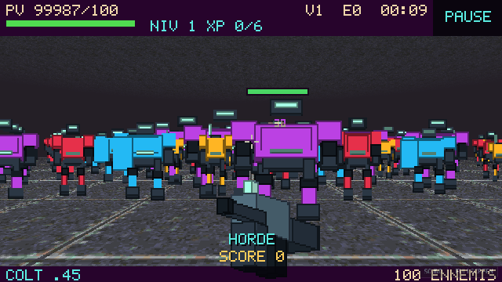
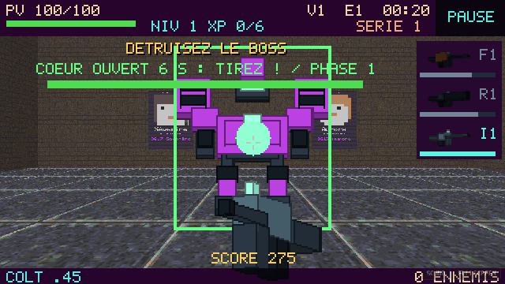

# Livraison — Mecha combat overhaul

Point de départ : `main` au SHA **ec4f45d920a70810a5c878f8cf8fcb3a2787e89c** (fusion de la RC). Travail exclusif sur **feature/mecha-combat-overhaul**. Aucun force push ni fusion dans main. Gameplay simulé : **19adfaf93cbff7c3650fd1e918a11f190ae9d6f5**. Optimisation finale du rendu : **ab00e9c995fb90e617cc4af7cb65f48db6a6984d**, qui masque les barres de PV pleines pour préserver les couleurs et réduire les appels graphiques. Les commits documentaires suivants consignent les mesures sans modifier le runtime.

## Commits d’implémentation

| SHA | Lot |
|---|---|
| e860683 | Atlas originaux, identités de classe et armes industrielles |
| f16623f | Sampler, grammaire mélodique et contrepoint déterministe |
| d752693 | Campagne à quatre seeds et progression persistante |
| 1fc74b5 | Combat, sniper, explosions, télégraphes et sièges Horde |
| c152470 | Pipeline Blender / PowerShell autonome |
| 25477b7 | Régressions et CI de la branche |
| ca668f2 | Mesures WebGL et documentation de génération |
| 19adfaf | Surface croissante par modules standards et fixtures de charge |
| ab00e9c | Lisibilité des classes et coût des barres de santé en foule |

## Fonctionnalités opérationnelles dans le code

Quatre méchas originaux à silhouettes distinctes : runner jaune/orange, guardian cyan avec bouclier, enforcer carmin avec canon, brute magenta à épaules larges et canons jumelés. Huit directions, idle, marche, attaque, impact et destruction. Les couleurs ne dépendent jamais des PV ; seules les unités blessées affichent leur barre de santé. Le diagnostic logiciel vu du dessus reprend aussi les quatre couleurs de classe ; les étincelles, cadres d’impact et fumée critique sont séparés. Les PNG de secours ont été examinés ainsi que des captures natives OpenGL montrant leur chargement dans le jeu.

Le siège appartient à cette famille et possède ses propres pods, canons et cœur. Les trois modules, la fenêtre du cœur et les transitions de phases existantes sont conservés. Les phases accélèrent les attaques, sans changer la couleur du châssis. Dans Horde, un seul boss apparaît aux vagues 5/10/15/etc. La vague n’est terminée qu’après sa destruction. Ses PV vont de 900 à 1800 maximum ; cadence, dégâts et durée d’ouverture varient dans des bornes distinctes. Les ennemis de la vague restent ses accompagnateurs.

Les sept stades principaux et leur puissance sont conservés : pistolet, double pistolet, automatique, double automatique, assaut, Gatling, double Gatling. Le renderer affiche vraiment les deux armes des stades doubles. Le bazooka est une secondaire, jamais un remplacement du dernier stade.

Les traçantes suivent le segment de collision validé. Le sniper attaque à longue portée et privilégie les enforcers puis les brutes visibles ; son rayon cyan dure 0,22 seconde. Bazooka et artillerie émettent de vrais projectiles dirigés vers un point, avec déplacement, arrêt sur géométrie, arrivée et dégâts de zone décroissants. Les murs bloquent également le souffle. L’explosion inflige un bonus au cœur ouvert. Le jet de flammes reste visible pendant toute l’activation et s’arrête sur la géométrie, avec les dégâts progressifs existants. Les cinq secondaires passent par le scheduler FIFO, séparées d’une croche au minimum ; recharge, effet continu et ordre d’attente sont sérialisés entre les maps.

Le runner court plus vite et presse au contact. Le guardian est plus large, plus résistant et bloque les passages. L’enforcer s’arrête à distance, prépare son tir pendant 0,65 seconde et verrouille une position esquivable. La brute prépare 0,8 seconde une frappe lente et dangereuse. Une nouvelle vérification de visibilité a lieu au moment de l’impact. Les soins et la fréquence des offres de vitalité baissent ; les HP des classes et le barème XP 2/3/4/6 restent inchangés. Le multiplicateur quotidien n’augmente plus les PV des ennemis.

## Musique

`RhythmClock` et les subdivisions des tirs restent le transport unique : 116 BPM puis +2 par niveau XP. L’horloge et le compteur de phrases ne redémarrent ni entre vagues ni entre maps quotidiennes.

`Sampler` réutilise kick/snare/clap/hat et le mixer SDL existant. Une banque bornée de notes basse/lead/contrepoint est synthétisée une fois par hauteur, puis rejouée par nom. Pas de nouvelle bibliothèque audio. L’enregistrement peut être retenté si le dispositif audio n’était pas prêt avant l’interaction utilisateur.

`ProceduralScore` possède son RNG musical séparé. Il choisit tonique, mode mineur naturel ou dorien et une forme de motif de six notes. Les phrases se répètent, avec une variation de fin et une évolution harmonique de quatre blocs. La seconde ligne est située sous le lead, avec des attaques en majorité décalées. Ses notes sont filtrées pour les consonances aux temps structurels et choisies près d’un mouvement contraire ou oblique. Le registre et l’absence de croisements sont vérifiés sur 1024 phrases. Basse, lead et seconde voix entrent progressivement ; la pression et les boss densifient les percussions. La victoire produit un accord de résolution. L’écoute artistique et la sortie sonore d’un téléphone physique restent à qualifier.

## Défi quotidien

Une seule entrée et une seule campagne : map 1/boss/trésor, résumé, map 2/boss/trésor, map 3/boss/trésor, map 4/boss final/trésor, victoire. Les trois premiers écrans ne proposent pas une victoire globale. Retry repart de la première map avec la date d’origine.

Date commune UTC, hash borné avec domaine `slave-rift/daily/v2/map/{stage}/{date}` ; les quatre seeds sont fixées avant le run. Musique et tirages d’upgrades ne peuvent pas modifier ces seeds. `CampaignRun::daily` accepte un futur jeu de quatre seeds serveur. Il n’y a ni backend ni dépendance au stockage navigateur.

12 / 20 / 30 / 44 salles principales, borne du générateur à 48, dimensions normales des portes et escaliers. Si le hasard fait baisser la surface d’un parcours pourtant plus long, des couloirs/salles simples sont remplacés dans l’ordre du graphe par des salles standards plus grandes. Ce choix reste déterministe, sans étirer les salles. La croissance stricte a été vérifiée sur 100 dates, soit 400 maps, y compris quatre dates qui faisaient échouer la première implémentation.

XP, niveau, arsenal, secondaires, upgrades, score, maximum de PV, temps, cooldowns, jet actif et scheduler passent à la map suivante. Soin de 35 % des PV manquants. Les seuils campagne des armes sont 3/5/8/11/14/17, avec les coûts XP habituels. Les quatre boss ont 1000 / 1200 / 1450 / 1750 PV. La pression vient aussi de la composition, du budget de rencontre, du délai d’apparition et des dégâts.

## Résultats des simulations finales

PHP 8.3, seeds 1 à 10 pour chaque politique, mêmes règles que le runtime. Les résultats détaillés sont dans [mecha-campaign-runs.jsonl](reports/mecha-campaign-runs.jsonl), le résumé dans [mecha-campaign-summary.json](reports/mecha-campaign-summary.json). Aucun PV, XP ou dégât n’est modifié par ces profils ; ils ne contrôlent que les entrées.

| Politique | Victoires | Durée des réussites | PV finaux moyens des réussites |
|---|---:|---:|---:|
| Faible | 0/10 | — | — |
| Moyen | 8/10 | 8 min 45 – 10 min 02 ; moyenne 9 min 27 | 55,2 % du maximum |
| Bon/agressif | 6/10 | 6 min 36 – 7 min 25 ; moyenne 6 min 59 | 91,7 % du maximum |

Par rapport aux 100 % et ~70 % de PV finaux de la précédente expérience moyenne, la pression augmente sans rallonger la cible à quinze minutes. Les moyennes finales sont niveau 19,4 pour les moyens victorieux et 18,5 pour les rapides victorieux : les deux découvrent la double Gatling. Le profil faible ne reçoit aucun avantage de cadence lente ; il perd avant d’exploiter longtemps des vagues supplémentaires.

Limite importante : le profil « bon » est une politique plus rapide et agressive, pas un modèle humain supérieur en toute situation. Son taux inférieur révèle encore une sensibilité du bot au placement, à la collecte et aux menaces. Ne pas interpréter ces trois lignes comme une courbe humaine de compétence ou comme un équilibrage terminé. L’objectif de durée est respecté sur l’échantillon moyen performant ; la sévérité du premier niveau et les pièges de navigation exigent une partie humaine.

## Performances et contrôles

[Mesure CPU](reports/mecha-cpu-performance.json), 300 pas par population fixe, armes désactivées, arène Horde :

| Ennemis | Temps CPU moyen/pas | P95 CPU |
|---:|---:|---:|
| 25 | 0,166 ms | 0,320 ms |
| 50 | 0,394 ms | 0,564 ms |
| 100 | 0,989 ms | 1,676 ms |
| 200 | 2,132 ms | 3,050 ms |

Ces temps ne mesurent pas le rendu. Le test navigateur conserve une population fixe 25/50/100/200, collecte le temps CPU de simulation par frame rendue, les temps de frame et le nombre réellement visible, puis capture chaque population en desktop et en profil mobile/HiDPI. Chromium utilise SwiftShader : ces résultats incluent un GPU logiciel, le navigateur et le CPU, et ne prédisent pas un téléphone matériel.

Contrôles locaux passés : 94 vérifications de simulation, **78 tests PHPUnit / 91 813 assertions**, parité des 153 fichiers du package, syntaxe Python et JavaScript, hashes et dimensions des 32 PNG, absence d’erreurs de whitespace. Toutes les CI sont **vertes sur `ab00e9c`** :

- [PHP 8.2/8.5, 30 campagnes et runtime natif SDL/OpenGL](https://github.com/tueb2024/slave-rift-jumphp/actions/runs/41721060549)
- [Export Windows](https://github.com/tueb2024/slave-rift-jumphp/actions/runs/41721060393)
- [WASM et interactions desktop/mobile/HiDPI](https://github.com/tueb2024/slave-rift-jumphp/actions/runs/41721060484)

Les deux profils navigateur ont effectué menus, pause, mort/replay, une campagne de quatre transitions, boss/modules/cœur/trésor/victoire et les quatre populations. Les transitions sont des fixtures contrôlées ; elles ne prétendent pas être une partie humaine complète. La règle de geste utilisateur reste activée pour l’audio ; l’audibilité et la qualité musicale ne sont pas évaluées par une capture.

Mesures finales Chromium/SwiftShader, temps moyen de frame rendue (CPU + navigateur + GPU logiciel, pas un temps GPU isolé) :

| Ennemis | Desktop | Mobile/HiDPI | Visibles |
|---:|---:|---:|---:|
| 25 | 48,5 ms | 98,1 ms | 24 |
| 50 | 51,4 ms | 99,4 ms | 49 |
| 100 | 54,1 ms | 107,0 ms | 99 |
| 200 | 64,5 ms | 121,7 ms | 199 |

[Desktop détaillé](reports/mecha-webgl-desktop.json) et [mobile détaillé](reports/mecha-webgl-mobile.json) contiennent les P95, tailles d’échantillon, viewport et le CPU de simulation par frame rendue. Ce dernier peut regrouper plusieurs pas fixes ; il ne faut pas le confondre avec le tableau CPU par pas ci-dessus. Les mesures avant suppression des barres pleines sont conservées dans les fichiers `*-before-bars.json` ; les exécutions CI ne constituent pas un benchmark matériel contrôlé sur un même téléphone.

Captures réelles de la révision finale, réduites à 640 × 360 en voisin le plus proche pour la documentation :





Téléchargements de playtest, conservés 14 jours par GitHub Actions : [Windows .exe](https://github.com/tueb2024/slave-rift-jumphp/actions/runs/41721060393/artifacts/13273540424) ; [build WASM](https://github.com/tueb2024/slave-rift-jumphp/actions/runs/41721060484/artifacts/13273336532). Connexion GitHub requise pour les artefacts. Le site de main n’a pas été republié par cette branche.

## Assets, commande et réserves

32 PNG originaux disponibles immédiatement, scripts de modèles procéduraux dans `tools/blender/`. Pas de `.blend` préfabriqué dans cette livraison : Blender n’est pas installé ici. Les modèles sont générés par la commande suivante, avec les atlas transparents et les icônes :

```powershell
powershell -ExecutionPolicy Bypass -File .\tools\blender\build_all_assets.ps1 -Blender "C:\Program Files\Blender Foundation\Blender 5.2\blender.exe"
```

Scripts : `art_spec.py`, `generate_mechas.py`, `generate_bosses.py`, `generate_weapons.py`, `render_sprites.py`, `build_all_assets.ps1`, `fallback_assets.py`, `verify_assets.py`. Le manifeste donne les hashes et l’origine du rendu. `EnemyAtlas`, `PlayScene` et `SecondaryHud` consomment les PNG ; les `.blend` ne sont pas empaquetés. Procédure et formats : [mecha-art-pipeline.md](mecha-art-pipeline.md). Provenance/licence : [ASSETS.md](../assets/ASSETS.md).

À qualifier humainement : rendu Blender 5.2.3 sur GTX/Windows, cadrages de ses atlas avant remplacement des secours, lisibilité en jeu réel, confort des cinq secondaires, écoute du contrepoint, audio après interaction et retour d’arrière-plan sur Android, campagne complète et boss Horde, framerate et thermique d’un téléphone physique. Les rendus de secours et les captures natives sont réels ; la génération `bpy` et les performances matérielles mobiles ne sont pas annoncées comme validées.
