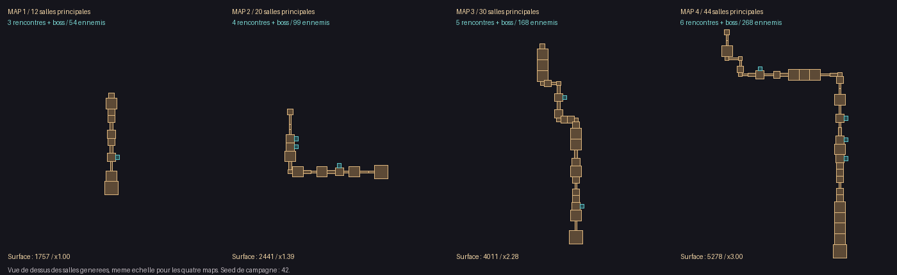

# JOUER — quatre maps de plus en plus grandes et denses

Branche `feature/play-progressive-campaign`, basée sur `main` à `e3d2185`.
Cette proposition est indépendante de `feature/issue-7-shotgun-art` : aucun asset
graphique de cette branche n’est incorporé et aucune fusion dans `main` n’a lieu.

Le bouton **JOUER** lance désormais une campagne aléatoire de quatre maps, au
lieu d’une unique map courte. La taille du parcours, le nombre de rencontres,
les budgets ennemis et la cadence augmentent. Les salles ne sont pas étirées :
les couloirs, escaliers et portes gardent leurs dimensions.

| Map | Salles principales | Rencontres avant le final | Ennemis, vague finale incluse | Plafond simultané |
|---|---:|---:|---:|---:|
| 1 | 12 | 3 | 54 | 12 → 16 |
| 2 | 20 | 4 | 99 | 16 → 20 |
| 3 | 30 | 5 | 168 | 20 → 24 |
| 4 | 44 | 6 | 268 | 24 → 28 |

Total : **589 ennemis**, plus un boss par map. Les budgets n’incluent pas les
modules du boss. Les départs passent de 1 ennemi toutes les 1,05 seconde sur
la première rencontre à des groupes de 3 toutes les 0,55 seconde sur les
rencontres avancées ; la présence simultanée reste plafonnée. Les pauses entre
rencontres diminuent de 3,5 à 2 secondes selon la map.



Le plan ci-dessus vient des salles effectivement générées, seed de campagne 42,
avec une échelle commune. La surface cumulée des salles passe de **1 757 à
2 441, 4 011 puis 5 278 unités²** pour cette seed : environ ×3 sur la dernière
map. La croissance stricte est vérifiée aussi sur les seeds 1, 1337 et 65520.
Les branches bonus existantes sont conservées. [Données complètes](geometry.json).

## Progression et interface

- Après chaque trésor : **MAP TERMINÉE**, puis **MAP SUIVANTE**.
- Victoire globale après le quatrième trésor seulement.
- XP, niveau, armes, améliorations, score, chronomètre et équipement secondaire
  sont conservés ; récupération de 35 % des PV manquants entre les maps.
- Les seuils d’armes normaux **4 / 8 / 12 / 16 / 20 / 24** restent ceux de JOUER.
  La progression quotidienne par kills ne remplace pas la progression XP normale.
- Le HUD indique **MAP 1/4…4/4** et le nombre de rencontres de la map.
- **REJOUER LES 4 MAPS** repart de la première map avec la même seed de campagne.
  **NOUVELLE CAMPAGNE** choisit une nouvelle seed. Ce sont des reprises complètes,
  pas des checkpoints de mort ; les libellés l’annoncent.

Les ennemis de cette campagne utilisent les points d’apparition éligibles de la
zone courante et un repli près du joueur, pour éviter de disperser les combats
loin derrière dans les grandes maps. Les portes empêchent de sauter les
rencontres ; la dernière rencontre ne relance pas de vague fantôme avant le boss.

Les règles de boss et du canon scié, leurs portées et le déclenchement manuel
restent inchangés. Les paramètres de difficulté croissants déjà définis pour
les quatre stages de campagne sont réutilisés, dont les PV du boss et la
composition des adversaires. Les PV des ennemis suivent une montée modérée
×1 / ×1,10 / ×1,20 / ×1,35 au début des maps, puis +2,5 % par rencontre.
Le **Défi du jour conserve ses 520 ennemis et ses règles propres** ; la Horde
et les fixtures explicites `GameMode::fixed()` conservent leur fonctionnement.

## Captures et vérifications

- [Entrée native de la map 1](screenshots/native-map-1.png) et [map 4](screenshots/native-map-4.png).
- [Menu JOUER dans WASM](screenshots/desktop-main.png).
- [Fin de map 1](screenshots/desktop-normal-map-1.png) et [victoire après map 4](screenshots/desktop-normal-map-4.png).
- [Fin de map 4 en mobile émulé](screenshots/mobile-normal-map-4.png).

Les quatre entrées natives et les transitions de menus sont des fixtures dans
le vrai runtime. Les transitions forcent la fin de map pour isoler l’interface ;
elles ne prétendent pas montrer quatre parties complètes jouées manuellement.
Le test navigateur utilise de vrais clics, touches et taps, vérifie la conservation
du niveau, les seeds de rejeu/nouvelle campagne, puis le Défi du jour, la Horde,
les upgrades, le tir manuel au cœur et la persistance musicale après reload.

Résultats locaux :

- **115 tests purs, 133 031 assertions**, réussis.
- **124 tests natifs SDL, 133 079 assertions**, réussis, dont un nouveau test
  d’intégration de JOUER jusqu’à la quatrième transition puis du rejeu.
- **94 contrôles de simulation**, réussis.
- **600 frames natives SDL/GLES2/Mesa**, depuis le menu avec une entrée de
  confirmation qui lance JOUER, réussies.
- **WASM Chromium desktop et mobile/HiDPI**, parcours complet réussi.
- **238 fichiers source/package** identiques ; syntaxe PHP/JS et diff vérifiés.

[Logs](logs/) et [simulation de campagne](campaign-simulation.json).

### Essai des politiques de simulation

Une seed (1), règles de JOUER, mêmes seuils d’armes que le joueur :

| Politique | Résultat | Maps atteintes |
|---|---|---:|
| Faible | Mort sur la map 1, après 54 éliminations | 1 |
| Moyenne | Encore en jeu à la limite de simulation sur la map 2 | 2 |
| Bonne | Victoire globale, 589 éliminations, environ 13 min 41 s | 4 |

Ce sont des politiques automatisées imparfaites, pas une estimation des chances
de victoire humaines. Le parcours moyen non terminé n’est pas présenté comme
réussi. Aucun objectif universel de durée ou d’équilibrage n’est garanti par cet
essai ; une revue en jouant reste utile avant intégration.

### Portée technique des validations

Le moteur natif est le runtime PHP 8.5/SDL déjà préparé pour le travail précédent.
Les smokes graphiques utilisent SDL GLES2 sous Mesa ; le défaut du backend
OpenGL par défaut relevé précédemment n’est pas corrigé dans cette branche.
Les dépréciations existantes PHP 8.5 sont exclues du niveau d’erreur natif
(`error_reporting=24575`), les autres avertissements restent fatals.

Le binaire PHP/WASM existant est conservé ; les sources PHP et assets de cette
branche sont repackagés dans son système de fichiers. Le code de JOUER est donc
exécuté réellement dans WASM, sans recompilation de l’outil C/Emscripten.
Chromium utilise SwiftShader et le mobile est émulé : aucune validation sur
un téléphone physique ou d’un exécutable Windows n’est annoncée. Les métriques
logicielle desktop/mobile sont conservées dans les JSON du dossier.

## Fichiers et reproduction

Production : `src/Game/GameMode.php`, `MenuFlow.php`, `Run.php` et
`src/Scene/PlayScene.php`, avec leurs copies sous `games/slave-rift/src/`.
Tests : `tests/NormalCampaignTest.php`, adaptation de `tests/GameSmokeTest.php`
et `tools/rc-browser-test.cjs` pour parcourir aussi les quatre maps normales.
Aucun asset, son ou code de `BossController` n’est modifié.

```sh
php tools/sync-package.php --check
phpunit -c phpunit.pure.xml
php tools/simulation-test.php
php tools/normal-campaign-report.php > docs/normal-progression/geometry.json
python tools/normal-campaign-layouts.py
php tools/campaign-sim.php 1 2-3-4-6 .35 legacy
# Runtime installé, sous X11/Xvfb :
SDL_RENDER_DRIVER=opengles2 JUMPHP_SMOKE=1 JUMPHP_HEADLESS_GL=1 JUMPHP_GL=1 \
  php -d error_reporting=24575 tools/normal-campaign-capture.php /chemin/jeu-installe work/captures
# Build web servi via HTTP avec COOP/COEP, Puppeteer disponible :
node tools/rc-browser-test.cjs http://127.0.0.1:18999/ work/browser-captures
```
